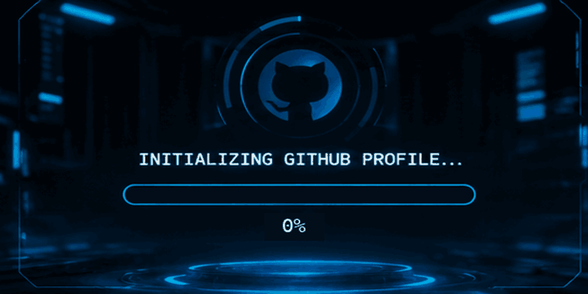

<!-- ===================================================== -->
<!--                 SHARAN DM PROFILE                     -->
<!-- ===================================================== -->

<!-- CINEMATIC INTRO ANIMATION -->

  

<!-- INTERACTIVE SOCIAL BUTTONS -->

  
  &nbsp;
  
  &nbsp;
  
  &nbsp;
  

---

<!-- ABOUT ME -->

<h2 align="center">⚡ ABOUT ME</h2>

  <b>AI & ML Enthusiast | Developer | Problem Solver</b>

  I'm a Computer Science student specializing in Artificial Intelligence
  and Machine Learning, passionate about building intelligent systems
  and technology-driven solutions.

- 🎓 CSE AIML student at Presidency University, Bengaluru.
- 🤖 Interested in Artificial Intelligence, Machine Learning and LLMs.
- 💻 Exploring Flutter, web development and intelligent applications.
- 🧠 Learning to build AI agents and task-specific language models.
- 🚀 Passionate about developing technology that solves real-world problems.

---

<!-- FEATURED PROJECTS -->

<h2 align="center">🚀 FEATURED PROJECTS</h2>

<table>
  <tr>
    <td width="50%" valign="top">
      <h3>🌱 Vyapti Kshetra</h3>
      

        AI-powered agricultural marketplace connecting farmers
        directly with factories.
      

      
<b>Focus:</b> AI Vision, RAG, Crop Grading, Agritech

    </td>
    <td width="50%" valign="top">
      <h3>🎮 LearnLab Quest</h3>
      

        Gamified, offline-first STEM learning platform helping
        students understand concepts through interactive simulations.
      

      
<b>Focus:</b> STEM, Simulations, Learning Analytics

    </td>
  </tr>
  <tr>
    <td width="50%" valign="top">
      <h3>🏫 Smart InCampus</h3>
      

        Smart campus management and navigation web application
        connecting students, teachers and parents.
      

      
<b>Focus:</b> Web Development, Campus Services

    </td>
    <td width="50%" valign="top">
      <h3>❤️ JanArogya</h3>
      

        AI-powered health management system designed to make
        healthcare information and services more accessible.
      

      
<b>Focus:</b> AI, Health Technology

    </td>
  </tr>
</table>

---

<!-- CURRENT FOCUS -->

<h2 align="center">🧠 CURRENT FOCUS</h2>

- Fine-tuning Small Language Models using LoRA and QLoRA.
- Building task-specific AI experts.
- Developing AI agents using Model Context Protocol (MCP).
- Exploring intelligent automation and AI-powered products.
- Experimenting with model training, evaluation and deployment.

---

<!-- TECH STACK -->

<h2 align="center">⚙️ TECH STACK</h2>

<h3 align="center">Programming Languages</h3>

  

<h3 align="center">Frontend & App Development</h3>

  

<h3 align="center">Backend & AI/ML</h3>

  

<h3 align="center">Tools & Platforms</h3>

  

---

<!-- GITHUB CONTRIBUTIONS -->

<h2 align="center">🐍 CONTRIBUTION ACTIVITY</h2>

  

---

<!-- GITHUB STATISTICS -->

<h2 align="center">📊 GITHUB STATISTICS</h2>

  
  

---

<!-- FOOTER -->

  

  <b>BUILDING • LEARNING • INNOVATING</b>

  <i>Turning ideas into intelligent solutions.</i>

