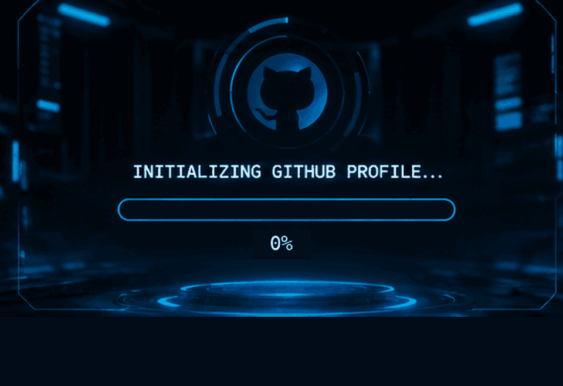

<!-- ===================== CINEMATIC PROFILE INTRO ===================== -->

  

<!-- ===================== CLICKABLE SOCIAL LINKS ===================== -->

  
  
  
  

---

<!-- ===================== ABOUT ME ===================== -->

<h2 align="center">⚡ ABOUT ME</h2>

  AI & ML enthusiast | Developer | Problem Solver

- 🎓 CSE AIML student at Presidency University, Bengaluru.
- 🤖 Interested in Artificial Intelligence, Machine Learning and LLMs.
- 💻 Exploring Flutter, web development and intelligent applications.
- 🧠 Learning to build AI agents and task-specific language models.
- 🚀 Passionate about developing technology that solves real-world problems.

---

<!-- ===================== PROJECTS ===================== -->

<h2 align="center">🚀 FEATURED PROJECTS</h2>

<table>
  <tr>
    <td width="50%">
      <h3>🌱 Vyapti Kshetra</h3>
      
AI-powered agricultural marketplace connecting farmers and factories.

      
<b>Focus:</b> AI Vision, RAG, Crop Grading, Agritech

    </td>
    <td width="50%">
      <h3>🎮 LearnLab Quest</h3>
      
Gamified, offline-first STEM learning platform for students.

      
<b>Focus:</b> Interactive Simulations, STEM, Learning Analytics

    </td>
  </tr>
  <tr>
    <td width="50%">
      <h3>🏫 Smart InCampus</h3>
      
Campus management and navigation web application.

      
<b>Focus:</b> Web Development, Campus Services

    </td>
    <td width="50%">
      <h3>❤️ JanArogya</h3>
      
AI-powered health management system.

      
<b>Focus:</b> Artificial Intelligence, Health Technology

    </td>
  </tr>
</table>

---

<!-- ===================== CURRENT FOCUS ===================== -->

<h2 align="center">🧠 CURRENT FOCUS</h2>

- Fine-tuning Small Language Models using LoRA and QLoRA.
- Building task-specific AI experts.
- Developing AI agents using Model Context Protocol.
- Exploring intelligent automation and AI-powered products.

---

<!-- ===================== TECH STACK ===================== -->

<h2 align="center">⚙️ TECH STACK</h2>

  

---

<!-- ===================== GITHUB CONTRIBUTIONS ===================== -->

<h2 align="center">🐍 CONTRIBUTION ACTIVITY</h2>

  

---

<!-- ===================== GITHUB STATISTICS ===================== -->

<h2 align="center">📊 GITHUB STATISTICS</h2>

  
  

---

<!-- ===================== FOOTER ===================== -->

  

  <b>BUILDING • LEARNING • INNOVATING</b>

