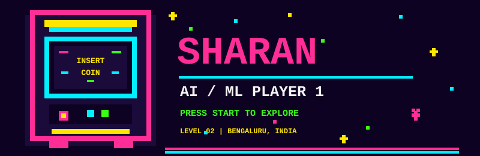
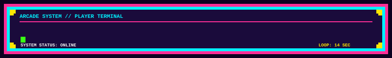
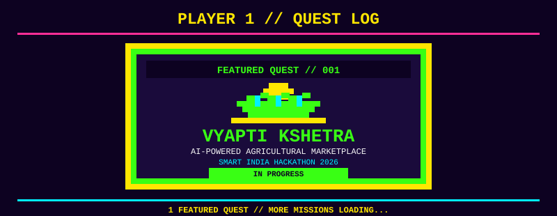

  

  

  

## 🕹️ PLAYER STATS

| ATTRIBUTE | PLAYER DATA |
|---|---|
| 🎮 Player | Sharan |
| 📍 Location | Bengaluru, India |
| 🎓 College | Presidency University |
| 🧠 Class | AI/ML Engineer |
| ⚡ Current Quest | LLM Agents & Fine-tuning |
| 📧 Contact | [sharandm18@gmail.com](mailto:sharandm18@gmail.com) |
| 🐙 GitHub | [@sharandm27-eng](https://github.com/sharandm27-eng) |

  

  

## 🏆 QUEST LOG

  

### 🎯 Quest 01 — MiniExpert
- Fine-tuning small language models using LoRA and QLoRA.
- Building task-specific AI experts.

🔗 [View MiniExpert Repository](https://github.com/sharandm27-eng/REPO_MINIEXPERT)

### 🎯 Quest 02 — MCP Agent
- Building agentic AI systems using Model Context Protocol.
- Exploring intelligent tool integration and automation.

🔗 [View MCP Agent Repository](https://github.com/sharandm27-eng/REPO_MCP_AGENT)

### 🎯 Quest 03 — Vyapti Kshetra
- AI-powered agricultural marketplace connecting farmers and factories.
- Smart India Hackathon 2026 project.

🔗 [View Vyapti Kshetra Repository](https://github.com/sharandm27-eng/REPO_VYAPTI_KSHETRA)

---

## 🐍 CONTRIBUTION SNAKE

  <picture>
    <source media="(prefers-color-scheme: dark)" srcset="https://raw.githubusercontent.com/sharandm27-eng/sharandm27-eng/output/github-contribution-grid-snake-dark.svg">
    <source media="(prefers-color-scheme: light)" srcset="https://raw.githubusercontent.com/sharandm27-eng/sharandm27-eng/output/github-contribution-grid-snake.svg">
    
  </picture>

---

## 🥇 HIGH SCORE

  <!-- GitHub stats may be temporarily rate-limited by the stats service. -->
  

  

  

